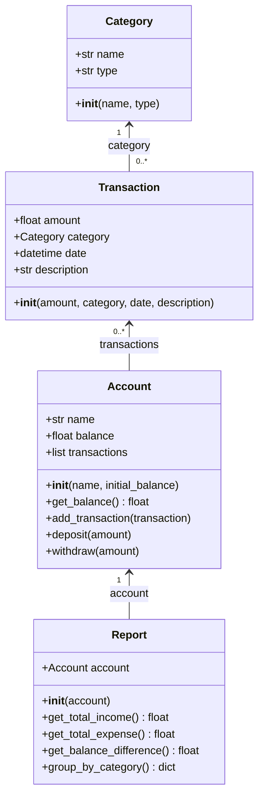

# UML-диаграмма классов проекта «Менеджер личных финансов»

## 1. Назначение проекта

«Менеджер личных финансов» — программа для учёта доходов и расходов пользователя. Она позволяет хранить информацию о финансовом счёте, создавать категории операций, добавлять доходы и расходы, а также формировать финансовые отчёты.

## 2. Описание классов

### 2.1. Класс `Category`

Класс предназначен для создания категорий финансовых операций.

**Атрибуты:**
- `name: str` — название категории, например «Еда» или «Зарплата».
- `type: str` — тип категории: `income` (доход) или `expense` (расход).

**Методы:**
- `__init__(name, type)` — создаёт категорию и проверяет корректность её названия и типа.

**Ограничения:** название категории не должно быть пустым. Тип должен быть равен `income` или `expense`.

### 2.2. Класс `Transaction`

Класс предназначен для хранения информации об одной финансовой операции.

**Атрибуты:**
- `amount: float` — сумма операции.
- `category: Category` — категория операции.
- `date: datetime` — дата и время операции.
- `description: str` — описание операции.

**Методы:**
- `__init__(amount, category, date, description)` — создаёт операцию и проверяет корректность суммы и категории.

**Ограничения:** сумма должна быть больше нуля. Категория должна быть объектом класса `Category`. Если дата не указана, используется текущая дата и время. Описание по умолчанию пустое.

### 2.3. Класс `Account`

Класс представляет финансовый счёт пользователя.

**Атрибуты:**
- `name: str` — имя или название счёта.
- `balance: float` — текущий баланс.
- `transactions: list[Transaction]` — список финансовых операций.

**Методы:**
- `__init__(name, initial_balance)` — создаёт счёт с начальным балансом.
- `get_balance()` — возвращает текущий баланс.
- `add_transaction(transaction)` — добавляет операцию в список и изменяет баланс в зависимости от её типа.
- `deposit(amount)` — пополняет счёт.
- `withdraw(amount)` — списывает средства со счёта.

**Ограничения:** начальный баланс не может быть отрицательным. Сумма пополнения и списания должна быть больше нуля. Нельзя списать больше средств, чем имеется на счёте, при использовании метода `withdraw()`.

### 2.4. Класс `Report`

Класс предназначен для формирования финансовых отчётов на основе операций счёта.

**Атрибуты:**
- `account: Account` — счёт, данные которого используются для формирования отчётов.

**Методы:**
- `__init__(account)` — создаёт отчёт для указанного счёта.
- `get_total_income()` — рассчитывает общую сумму доходов.
- `get_total_expense()` — рассчитывает общую сумму расходов.
- `get_balance_difference()` — рассчитывает разницу между доходами и расходами.
- `group_by_category()` — группирует суммы операций по названиям категорий.

## 3. UML-диаграмма классов

## 4. Связи между классами

1. **`Category` и `Transaction`.** Каждая операция содержит ссылку на одну категорию. Одна категория может использоваться в нескольких операциях.
2. **`Account` и `Transaction`.** Счёт хранит список финансовых операций. Добавление операции через `add_transaction()` изменяет баланс счёта.
3. **`Account` и `Report`.** Отчёт получает счёт и использует его операции для расчёта доходов, расходов и группировки по категориям.

## 5. Принципы проектирования

Классы разделяют обязанности программы:
- `Category` отвечает за категории доходов и расходов.
- `Transaction` описывает отдельную финансовую операцию.
- `Account` управляет балансом и списком операций.
- `Report` выполняет расчёты и формирует сводную информацию.

Для проверки корректности данных используются исключения `ValueError`.

В текущей реализации атрибуты классов открытые: они доступны напрямую. Например, баланс можно получить через `account.balance`, а также через метод `account.get_balance()`. При дальнейшем развитии проекта можно усилить инкапсуляцию, ограничив прямое изменение важных атрибутов и предоставив доступ через публичные методы.

## 6. Вывод

Разработанная UML-диаграмма отражает структуру основных классов проекта «Менеджер личных финансов», их атрибуты, методы и взаимосвязи. Такое представление помогает понять устройство программы и служит основой для дальнейшей разработки пользовательского интерфейса и тестирования.